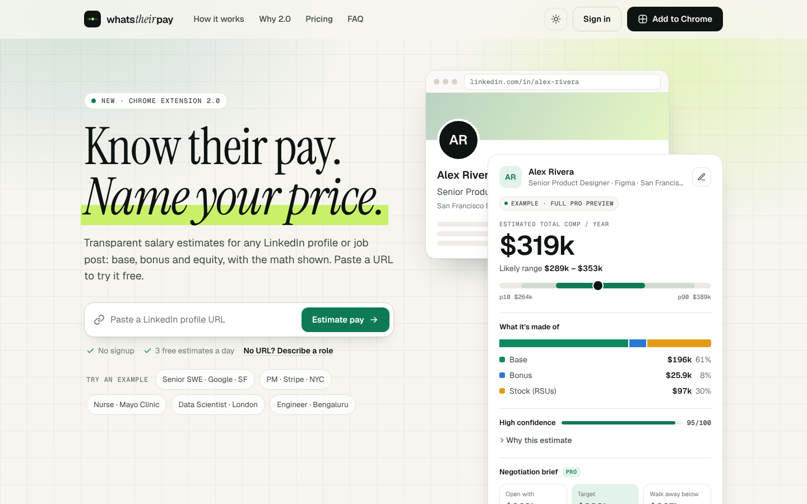

# WhatsTheirPay

Transparent pay estimates for any LinkedIn profile or job post: a Chrome extension, a landing page with a paste-a-URL free try, and the API behind both.



**Read first:** [docs/PRODUCT.md](docs/PRODUCT.md) covers the research on PayPeek, the pain points, personas, user flows, UX decisions, pricing, rate limits, metrics, risks and roadmap.

## Quick start

Requires **Node 22.18+** (the server runs TypeScript directly and uses the built-in SQLite).

```bash
cd server
npm install
npm start            # http://localhost:8787
```

Open <http://localhost:8787> and paste a LinkedIn profile URL, or click an example.

Out of the box everything works without third-party accounts:

- **Sign-in codes** print in the server console (and auto-fill in the UI) until `RESEND_API_KEY` is set.
- **Upgrades** go through a built-in test checkout until `STRIPE_SECRET_KEY` is set.
- **Pasted URLs** ask for title, company and city until `PDL_API_KEY` (People Data Labs) is set.

### Load the extension

1. Open `chrome://extensions`, turn on **Developer mode**, click **Load unpacked**, and choose the `extension/` folder.
2. Open a LinkedIn profile or job and click the pay chip next to the name.

The extension calls `http://localhost:8787` by default. Change it in the popup under **Developer**.

## What's in the repo

```
server/      API + static host (Hono, node:sqlite, TypeScript without a build step)
  src/plans.ts             pricing, quotas, burst limits, feature gates (single source of truth)
  src/estimator/           deterministic, explainable comp model + posted-salary parser
  src/resolvers/           LinkedIn URL parsing and the enrichment chain
  src/services/            accounts and email codes, usage ledger, Stripe billing, email
  src/extension-config.ts  remote LinkedIn selectors for the extension
  test/                    node:test suites
web/         landing, account, test checkout, methodology and privacy pages (no build step)
extension/   Chrome Manifest V3 extension (no build step)
shared/      the estimate card used by both web and extension
docs/        product brief
```

The estimate card is written once in `shared/card.js` and copied into `web/assets/js/` and `extension/src/`. After editing it, run `npm run sync` from the repo root (`npm test` fails if the copies are stale).

## Configuration

Copy `server/.env.example` to `server/.env`. All values are optional in development.

| Variable | Purpose |
|---|---|
| `PORT`, `PUBLIC_URL` | Where the server listens and how it links to itself |
| `APP_SECRET` | Signs IP hashes and codes. **Required in production.** |
| `TRUST_PROXY=1` | Trust `X-Forwarded-For` behind a load balancer |
| `WEB_ORIGINS`, `EXTENSION_IDS` | Extra allowed browser origins; allowed extension IDs in production |
| `DATABASE_PATH` | SQLite file (default `server/data/wtp.db`) |
| `RESEND_API_KEY`, `EMAIL_FROM` | Email delivery for sign-in codes |
| `STRIPE_SECRET_KEY`, `STRIPE_WEBHOOK_SECRET`, `STRIPE_PRICE_PRO_MONTHLY`, `STRIPE_PRICE_PRO_YEARLY`, `STRIPE_PRICE_PRO_PASS` | Stripe Checkout and webhooks. Point the webhook at `/v1/billing/webhook` (events: `checkout.session.completed`, `customer.subscription.*`). The pass is a one-time price. |
| `PDL_API_KEY` | Resolve pasted profile URLs via People Data Labs |

## Tests

```bash
npm test             # from the repo root: API + estimator tests, then the shared-file sync check
cd server && npm run typecheck
```

## Before going to production

- Set `APP_SECRET`, `NODE_ENV=production`, `PUBLIC_URL`, and `TRUST_PROXY` if you're behind a proxy.
- Configure Stripe (three prices plus the webhook) and Resend.
- In the extension: set `DEFAULT_API_BASE` in `extension/src/background.js`, put that host in `host_permissions`, and remove `http://localhost:8787/*`. Then add the published extension ID to `EXTENSION_IDS`.
- Set `CHROME_STORE_URL` in `web/assets/js/app.js` once the listing is live.
- Run more than one server instance? Move the burst limiter (`server/src/lib/ratelimit.ts`) to Redis.
- Calibrate `server/src/estimator/data.ts` against real datasets and keep `web/methodology.html` in sync (see the roadmap in the product brief).

WhatsTheirPay is not affiliated with LinkedIn. Estimates are market-based and are not anyone's actual pay.
