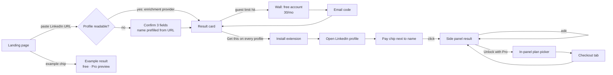

# WhatsTheirPay 2.0: product brief

*Owner: Product · Status: v2.0 built (MVP), pre-launch · Last updated: Oct 2026*

## TL;DR

PayPeek proved there is demand for "see the pay behind a LinkedIn profile", then lost users on trust and reliability: a 1-star store rating, an extension that (by your own test) doesn't work, three different free-tier limits and two different accuracy claims on its own site, and a black-box number built on top of general-purpose chatbots.

WhatsTheirPay 2.0 competes on the things PayPeek got wrong rather than on the same promise:

1. **Try before you install.** Paste a LinkedIn URL on the landing page and get a real estimate. No signup.
2. **Show the math.** Every estimate is a range with a confidence score and the five factors that produced it. Users can edit any input and watch it recalculate.
3. **Never dead-end.** If a page can't be read, the user fills in three fields instead of seeing an error. Page selectors are hot-fixable from the server.
4. **Fair, legible limits.** On-demand only, re-views free, 3/day without an account, 30/month free, and a 30-day pass that never renews.

The estimator is deterministic (no LLM call per lookup), so a lookup costs us close to nothing. That cost structure is what makes the generous free tier and the low price viable.

---

## 1. Research: what's broken today

> **Method note.** This environment's network policy blocked direct access to `paypeek.ai`, `chromewebstore.google.com` and `paperclip.fyi`, so I couldn't read individual review text. The findings below come from search-indexed copies of PayPeek's own pages and store listings, plus your report that the app isn't functional. Treat review-level conclusions as inferred from aggregate signals.

### PayPeek

| Signal | What we found |
|---|---|
| Store rating | The "PayPeek: instant salary check…" listing showed **1.0★** (from 2, later 4 ratings). The same listing appears under more than one title. [Chrome Web Store](https://chromewebstore.google.com/detail/paypeek-instant-salary-ch/aenhepbomobiielgagkkaagkbjaljobj) |
| Works at all? | You tested it and it isn't functional. Combined with the rating, the core loop (open profile → see number) appears broken. |
| Free tier | Three different numbers on its own properties: **15/month** ([pricing](https://paypeek.ai/pricing)), **3/month** ([homepage](https://paypeek.ai/)), and 5/month in another variant. The homepage also says "Free during beta". |
| Price | **$10/mo or $120/yr** on the pricing page vs **$11.99/mo** on the homepage. |
| Accuracy claim | "Within **±7%**" on the homepage vs "within **10–15%**" elsewhere, both from undisclosed internal benchmarking. The [terms](https://paypeek.ai/p/terms) disclaim any warranty of accuracy. |
| Method | Described as a lightweight agent on top of Claude, ChatGPT and Gemini. That implies a per-lookup model cost (consistent with the stingy free tiers) and answers that can vary between runs. |
| Brand hygiene | A PayPeek-branded page lives on a different domain ([paperclip.fyi](https://www.paperclip.fyi/)) and one vendor page links to a store slug for "paperclip". Looks like an unfinished rebrand. |
| Trust | Domain owner hidden behind WHOIS privacy ([ScamAdviser](https://www.scamadviser.com/check-website/paypeek.ai)). Desktop only ([mobile page](https://paypeek.ai/mobile)). Social framing ("paycheck leaderboard of your connections") reads as voyeuristic rather than useful. |

### The rest of the category

| Product | Gap |
|---|---|
| [Salary Inspector](https://chromewebstore.google.com/detail/salary-inspector/ohdgikkchafapofonnddadalgedibpca) | US-only (H-1B data), last updated 2016, 3.0★ from 5 ratings, shows errors when it can't match a title. |
| [PayPredict by Figures](https://figures.hr/post/meet-paypredict-the-linkedin-chrome-extension-for-instant-salary-estimates) | Europe and € only, and your employer must be a Figures customer. |
| Estim8.ai | US software engineers only. |
| [LinkedIn Salary Estimator](https://chromewebstore.google.com/detail/linkedin-salary-estimator/eimdinclgnnhknhgfddakljhfecdhchm) | 2.2★. |

**The pattern:** the category suffers from *reliability* (LinkedIn DOM changes break extensions silently), *opacity* (a single number nobody can sanity-check), and *narrow coverage* (one country, one role, one currency).

## 2. Pain points → principles → what we built

| # | Pain point | Principle | What 2.0 does |
|---|---|---|---|
| 1 | Extension breaks, user sees nothing | **Never dead-end** | Selectors served from `/v1/extension/config` (data, so MV3-compliant) and fixable in minutes. Floating button if the name can't be found. A prefilled 3-field form if the title can't be read. |
| 2 | Black-box number | **Show the math** | Range (p25–p75), confidence 0–100, and the five factors with multipliers. Editable inputs. Public [methodology](../web/methodology.html). |
| 3 | Can't evaluate before paying | **Value before signup** | Paste-a-URL try on the landing page. 3 guest estimates/day in the web *and* the extension. Examples are free and show the full Pro card. |
| 4 | Credits burned silently | **On-demand by default** | Nothing is sent until the user clicks. Re-viewing within 30 days is free, and so are 10 edits per lookup. Auto-reveal is opt-in (Pro). |
| 5 | Confusing, inconsistent pricing | **One source of truth** | Plans, limits and copy come from `server/src/plans.ts` via `/v1/plans`. The landing page and extension render from it, so they can't disagree. |
| 6 | Subscription anxiety | **Price the job hunt** | A 30-day pass that never renews, alongside monthly (one-click cancel) and yearly. |
| 7 | US-only, $-only | **Local by default** | ~30 US metros and 50+ countries, in local currency with a USD reference. Global employers vs local firms are priced differently in emerging markets. |
| 8 | "Creepy" | **Market framing + consent** | Copy says "market estimate for this role", never "their salary". Anyone can opt their profile out without an account. No social leaderboards. |

## 3. Users and jobs to be done

| Persona | Job to be done | Frequency | Willingness to pay | What wins them |
|---|---|---|---|---|
| **Job seeker** (primary, volume) | "Before I talk numbers, I want a defensible market range so I don't anchor low." | Bursty: 4–12 weeks around a search | Medium, episodic | Negotiation brief, posted-range check, the 30-day pass |
| **Recruiter / sourcer** (primary, revenue) | "Before the first call, I want to know the band this person expects." | Daily | High | Volume (1,000–3,000/mo), history, CSV, speed |
| **Hiring manager / founder** | "Is our offer competitive for this city and level?" | Monthly | Medium | Editable inputs, employer-type and city comparisons, explainable method |
| Curious browser | "What does my ex-colleague make?" | Rare | Low | Served by the free tier; we deliberately don't build for voyeurism (no leaderboards). |

## 4. User flows



**A. Web try (anonymous).** Paste a URL; it auto-submits on paste. The URL is validated client-side, then server-side. With an enrichment provider configured, fields resolve automatically. Without one, the card asks for title (required), company and city (recommended), with the name already filled in from the URL slug. The result shows inline where the illustration was, so the layout doesn't jump. The CTA is "Get this on every LinkedIn profile". *Decision: the hero illustration **is** the real result component rendering a real engine response, so the first card a visitor sees is exactly the product.*

**B. Install → first value.** `onInstalled` opens the site with a "you're set" toast. On a profile, a chip appears after the name: **Estimate pay**. Click it to open a 400px side panel with the result, and the chip turns into the range. *Decision: inline chip over overlay. It sits where the eye already is and costs nothing until clicked.*

**C. Guest → free account.** When the guest limit hits, the panel shows the wall with a countdown, and sign-up happens **inside the panel** with a 6-digit email code. No tab switch and no magic link (links break the flow out of the extension). The blocked lookup then resumes automatically.

**D. Upgrade.** In the extension, an in-panel picker (pass / monthly / yearly) opens checkout in a new tab, then "I've paid, refresh" unlocks the Pro sections immediately. On the web, the pricing toggle leads to sign-in (if needed) and then checkout. Every Pro feature is visible-but-locked in the free card (blurred negotiation brief, hatched p10/p90 tails), so the upgrade is concrete.

**E. Job posts.** The chip reads "Market pay for this job". Where a salary range is posted (pay-transparency laws), the card annualizes it and flags it as above, at or below market median base.

**F. Edits.** Users can edit any input (title, company, city, years, employer type, level). The first 10 edits per lookup are free, which makes the tool useful for "what if I moved to Austin?" without being abusable as unlimited free lookups.

**G. Opt-out.** Anyone, no account. We stop estimating the profile for all users and delete stored lookups of it (`451` from then on).

## 5. Key UX decisions (and why)

1. **Ranges, not points.** Comp is a distribution. A precise-looking wrong number destroys trust faster than an honest range. Range width is driven by confidence, so the UI teaches users what drives accuracy.
2. **"Improve accuracy" chips** (e.g. *Add a city +16*) turn missing data into an action instead of a silent quality drop.
3. **Hero figure in sans, ranges as a band.** The median is the one big number. The band (p25–p75 solid, p10–p90 tails, median dot) and the stacked base/bonus/equity bar follow a validated, colorblind-safe palette, with every series labeled in text.
4. **Paid features are visible, not hidden.** Locked sections appear in place (blurred or hatched). People upgrade for things they can see.
5. **Email codes instead of passwords or magic links.** A code works inside a popup or side panel, while a link pulls the user out of LinkedIn.
6. **Closed shadow DOM for all injected UI.** LinkedIn's CSS can't break us, our CSS can't break LinkedIn, and page scripts can't read our panel.
7. **The panel follows LinkedIn's light/dark theme** by sampling the page background, not a class name that can change.
8. **No API calls on page load.** Opening LinkedIn tabs doesn't touch the burst limit or the server. Only clicks (or opt-in auto-reveal) do.
9. **Paste-to-estimate** on the landing page removes a click at the moment of highest intent.
10. **Guests are first-class in the extension.** Requiring signup before the first estimate is the biggest leak in an install funnel.

## 6. Pricing and packaging

| | Guest | Free | Pro | Team |
|---|---|---|---|---|
| Price | $0 | $0 | **$12/mo · $96/yr · $15 30-day pass** | $39/seat/mo (yearly), sales-led |
| Estimates | 3 / rolling 24h | 30 / month | 1,000 / month | 3,000 / seat / month |
| Range | p25–p75 | p25–p75 | p10–p90 | p10–p90 |
| Base / bonus / equity split, "why", edits | ✓ | ✓ | ✓ | ✓ |
| Negotiation brief (ask / target / walk-away + talk track) | Locked preview | Locked preview | ✓ | ✓ |
| Auto-reveal on profiles | — | — | ✓ | ✓ |
| History | — | Last 10 | 500 + CSV | 5,000 + CSV |

**Rationale**

- **Value metric = unique lookups**, not page views. Re-views are free, so "credits" map to real decisions.
- **Generous free tier because marginal cost is ~0.** A deterministic engine on SQLite costs fractions of a cent per lookup, whereas an LLM call per lookup pushes toward 3-a-month tiers like PayPeek's. URL enrichment (People Data Labs) is the only real per-lookup cost, and it's cached for 30 days.
- **The 30-day pass is priced above monthly ($15 vs $12) on purpose.** It sells *certainty* to people burned by forgotten subscriptions, and it's the honest product for a job hunt. Monthly stays the cheaper per-month option for ongoing users.
- **Yearly at $8/mo** targets recruiters and managers with continuous use.
- **Team is sales-led for now.** Seats, SSO and an API need a conversation, and it keeps v1 scope small. The backend already supports the `team` plan's limits.

## 7. Rate limits and abuse controls

Two independent layers, plus targeted limits on sensitive endpoints:

| Layer | Mechanism | Limits | Response |
|---|---|---|---|
| **Burst** (all `/v1/*`) | Token bucket per subject (user ID, or salted hash of IP for guests); refills continuously | Guest 10/min · Free 20 · Pro 60 · Team 120 | `429 rate_limited` + `Retry-After`, `RateLimit-Limit/Remaining/Reset` headers |
| **Quota** (`POST /v1/estimate`) | Durable ledger in SQLite; counts unique lookups per period | Guest 3 per rolling 24h · Free 30 / calendar month · Pro 1,000 · Team 3,000 | `429 quota_exceeded` with the quota object and an `upgrade` hint (`signup` or `upgrade`); `X-Quota-*` headers on every estimate |
| Free re-views | Same subject + same profile within 30 days | Unlimited | `charged: false, chargeReason: "review"` |
| Free edits | Changed inputs on an existing lookup | 10 per lookup, then the next edit counts as new | `chargeReason: "adjustment"` |
| Sign-in codes | Per IP: 10/hour. Per email: 3 per 10 min. Code: 10-min TTL, 5 attempts, HMAC-hashed at rest | | `429` / `400` with plain-language messages |
| Examples | Allowlisted IDs only | Free, burst-limited | `chargeReason: "example"` |

**Implementation notes.** The quota check and the ledger write run synchronously with no `await` in between, so concurrent requests can't double-spend under Node's single thread. Guests' IPs are never stored raw (HMAC with the app secret). The burst limiter is in-memory: swap it for Redis (same algorithm) before running more than one instance.

## 8. System design

```
extension/ (MV3)                         web/ (static, served by the API)
  content.js ── chip + panel (shadow DOM)  index.html  try box, examples, pricing
  background.js ─ only network client      account.html, checkout.html (test mode)
  popup.html ── plan, quota, settings      methodology.html, privacy.html
        │                                        │
        └──────────── HTTPS / JSON ──────────────┘
                          │
server/ (Node 22, Hono, node:sqlite)
  plans.ts            pricing + limits (single source of truth)
  estimator/          deterministic, explainable model + salary-range parser
  resolvers/          LinkedIn URL parsing, cache → People Data Labs → slug fallback
  services/           accounts (email codes, sessions), usage ledger, billing, email
  extension-config.ts remote selectors (hot-fix LinkedIn changes)
```

**No server-side LinkedIn scraping.** Profile data comes from the page the user is already viewing (extension), from a licensed provider (URL try, if configured), or from the user. This is the defensible position on LinkedIn's terms and on data protection.

### API surface

| Method & path | Purpose |
|---|---|
| `GET /v1/plans` | Plan catalog, limits, rules (`freeReviewWindowDays`, `freeAdjustmentsPerLookup`, `passDays`) |
| `POST /v1/estimate` | `{ url?, profile?, overrides?, lookupId?, example?, source }` → `ok` or `needs_input` |
| `GET /v1/examples` | Free sample roles |
| `POST /v1/auth/start`, `/v1/auth/verify`, `/v1/auth/logout` | Email-code auth; bearer tokens (hashed at rest) |
| `GET /v1/me` | User, effective plan, quota, subscription |
| `GET /v1/history`, `/v1/history.csv` | History (plan-limited), CSV export (Pro) |
| `POST /v1/billing/checkout`, `/v1/billing/portal`, `/v1/billing/webhook` | Stripe Checkout, Customer Portal and signed webhooks; a built-in test checkout when Stripe isn't configured |
| `POST /v1/privacy/opt-out` | Suppress a profile for everyone |
| `GET /v1/extension/config` | Remote selectors and feature flags |

## 9. Metrics

- **North star:** weekly active estimators (users who view at least one estimate in a week).
- **Acquisition:** landing try → result rate; result → install CTA click; install → first estimate within 24h.
- **Activation:** guest → free account conversion at the wall; share of estimates with ≥1 edit (engagement with the "why").
- **Monetization:** free → paid conversion; pass vs. subscription mix; pass → subscription upgrade.
- **Quality guardrails:** extraction success rate (`needs_input` share from the extension, a direct proxy for LinkedIn breakage), API error rate, median confidence score, and wall-hit rate (if too high, the free tier is mis-sized).
- **Trust guardrails:** opt-out volume, uninstall-survey reasons, store rating (target ≥4.5★).

## 10. Risks and mitigations

| Risk | Likelihood / impact | Mitigation |
|---|---|---|
| LinkedIn changes DOM | High / High | Remote selectors, floating-button fallback, never-dead-end form; track the `needs_input` rate as an alert. |
| LinkedIn terms / platform enforcement | Medium / High | Reads only the page the user views, on click; no crawling, automation or bulk export; no server-side scraping; minimal permissions. **Get legal review before launch.** |
| Accuracy perceived as wrong | Medium / High | Ranges + confidence + visible factors; editable inputs; calibrate benchmarks against public datasets before launch (see roadmap). |
| Data protection (estimates about identifiable people) | Medium / High | Market framing, data minimization (guests store no names or URLs), universal opt-out, no resale. Needs a legitimate-interest assessment for the EU and UK. |
| Chrome Web Store review | Medium / Medium | Single purpose, `storage` + LinkedIn host only, no remotely hosted code (config is data). Remove `localhost` from `host_permissions` for the store build. |
| Abuse (scraping via our API) | Low / Medium | Burst + quota layers, email-verified accounts, per-IP code limits; Team API keys later with their own quotas. |

## 11. Roadmap

**Before launch (must-do)**
- Calibrate the role benchmarks and multipliers in `server/src/estimator/data.ts` against public datasets (BLS OES, H-1B LCA disclosures, pay-transparency job postings) and publish the validation error. Today's numbers are hand-set reference values, sanity-checked against known market points (see `server/test/estimator.test.ts`).
- Configure Stripe, Resend and the production API host; legal review of terms, privacy and LinkedIn exposure.

**Next**
- People Data Labs enrichment on by default for the web try (cost-capped, cached 30 days).
- Opt-in "share posted ranges": the extension contributes anonymized `(title, company, location, posted range)` tuples from job pages, a proprietary data flywheel that improves calibration.
- Offer comparison (two offers side by side, 4-year value with vesting).
- Edge and Firefox builds (same code, different manifest keys).

**Later**
- Team workspace: seats, shared history, SSO, API keys, admin billing.
- Mobile: share-sheet extension ("Share a LinkedIn profile → get an estimate").
- Redis-backed limiter and Postgres for multi-instance scale.

## 12. What's real vs. stubbed in this build

| Area | Status |
|---|---|
| Estimator, quotas, burst limits, auth, history, CSV, opt-out | **Working**, covered by tests |
| Stripe Checkout, Portal, webhooks | **Implemented**; needs keys and price IDs. Without them a built-in test checkout applies plans, so the full upgrade flow is demoable. |
| Email delivery | **Implemented** (Resend); without a key, codes print to the server console and are auto-filled in development |
| URL → profile enrichment | **Implemented** (People Data Labs), not exercised without a key; falls back to the 3-field form |
| Extension on real LinkedIn | Verified against LinkedIn-like fixture pages, **not** against live LinkedIn (unreachable from the build environment). Expect a selector pass on first real use; that's what remote config is for. |
| Chrome Web Store listing | Not yet published; "Add to Chrome" explains load-unpacked until `CHROME_STORE_URL` is set in `web/assets/js/app.js`. |
